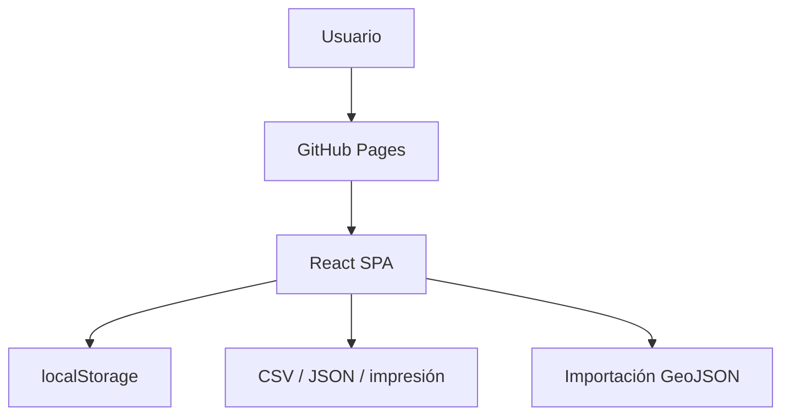
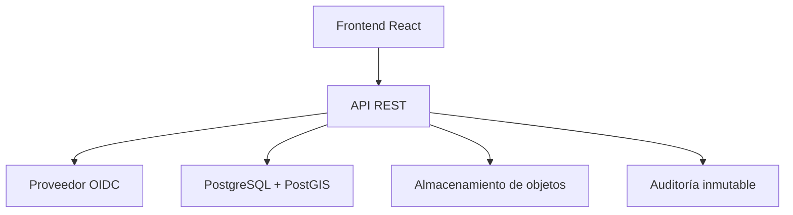

# Arquitectura

## Agente SIGPI IA y visuales conceptuales

La versión pública incluye un motor interactivo local, verificable y sin credenciales, para aplicar filtros, seleccionar parques, comparar superficies, identificar concentraciones preliminares y exportar CSV. La integración GPT se habilita exclusivamente mediante un endpoint de servidor definido en `VITE_SIGPI_AGENT_API_URL`. El servidor debe custodiar la clave, aplicar autenticación, cuotas, validación y registro de auditoría. No se admite una clave de OpenAI en Vite ni en GitHub Pages.

Los visuales hiperrealistas 3D son imágenes conceptuales generadas para la interfaz; no constituyen fotografías, proyectos aprobados ni ubicaciones reales.

## Implementación actual

SIGPI v0.6 es una aplicación de página única React/Vite. No usa rutas del servidor, por lo que funciona en GitHub Pages sin reglas de reescritura. Los módulos comparten un estado en memoria que se guarda, con versión de esquema, en `localStorage`.

La vista pública limita la navegación a Dashboard, Parques, GIS y Reportes. La vista interna habilita formularios, evaluación, documentos y administración, pero esta separación es visual: no es un mecanismo de seguridad.

## Modelo objetivo operativo

Requisitos mínimos del backend:

- autenticación OIDC y autorización por roles;
- API con validación de esquema y controles de acceso por objeto;
- PostgreSQL/PostGIS para geometrías, consultas territoriales y consistencia transaccional;
- almacenamiento privado versionado para documentos;
- antivirus, límites de tipo/tamaño y enlaces de descarga de corta duración;
- bitácora de cambios, copias de seguridad y recuperación;
- separación de ambientes y gestión de secretos fuera del repositorio.

## Datos

La base histórica recuperada proviene del paquete v0.1 y conserva el corte declarado de julio de 2025. No se presenta como estadística oficial vigente en 2026. Los proyectos y metadatos documentales precargados son ficticios y están identificados como tales.

## GIS

La versión estática valida la estructura GeoJSON, limita la importación a 5 MB y 5.000 entidades y dibuja polígonos sobre una vista nacional simplificada. No transforma sistemas de referencia. Para uso técnico, el backend deberá rechazar o transformar CRS no admitidos y validar topología, extensión, precisión y correspondencia catastral.

## Servicios y costos

| Servicio | Uso actual | Costo previsto |
|---|---|---|
| GitHub | Repositorio y Actions | Según plan de la cuenta |
| GitHub Pages | Hosting del frontend público | Sin costo adicional en repositorios públicos; sujeto al plan y límites de GitHub |
| Backend/PostGIS | No implementado | Pendiente de selección y autorización |
| Almacenamiento documental | No implementado | Pendiente de selección y autorización |

